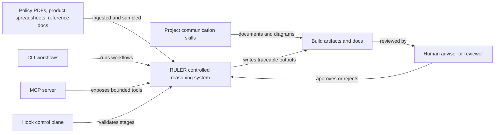
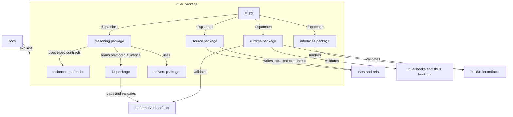
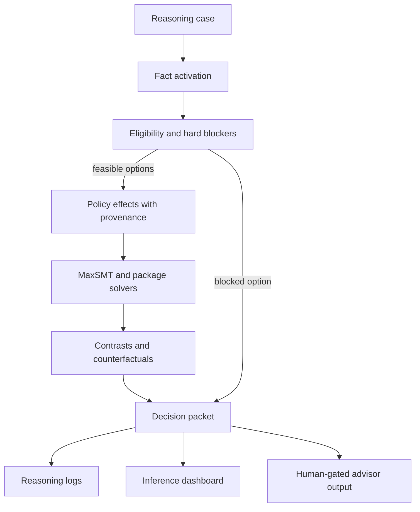
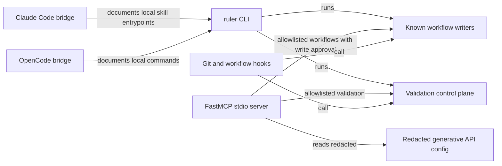

<!--
SPDX-FileCopyrightText: Copyright © 2026 Idiap Research Institute <contact@idiap.ch>
SPDX-FileContributor: André Freitas <andre.freitas@idiap.ch>
SPDX-License-Identifier: LicenseRef-Idiap-Research-Education
-->

# RULER Architecture Diagrams

These diagrams provide project-management views of the RULER system. They are
kept separate from the main README so architecture communication can evolve
without changing the user-facing project entrypoint.

## System Context

## Component View

## Source to KB Flow

```mermaid
flowchart LR
  Raw[Raw source documents]
  Extracted[Extracted text and workbook samples]
  Candidates[Formalizable units and draft predicates]
  Vocabulary[Vocabulary normalization and translation controls]
  Gates[Semantic and drift validation gates]
  Promoted[Promoted KB clauses, rules, predicates]
  Reasoner[Reasoning cases and policy effects]

  Raw -->|download and extract| Extracted
  Extracted -->|sample and structure| Candidates
  Candidates -->|harmonize terms| Vocabulary
  Vocabulary -->|validate preservation| Gates
  Gates -->|promote only accepted artifacts| Promoted
  Promoted -->|grounds| Reasoner
```

## Reasoning Control Flow

## Runtime Integration View

## Source Notes

These diagrams are derived from:

- `ruler/cli.py`
- `ruler/runtime/validation.py`
- `ruler/runtime/mcp_server.py`
- `ruler/reasoning/`
- `ruler/kb/`
- `ruler/source/`
- `ruler/interfaces/`
- `.ruler/hooks.yaml`
- `skills/SKILL_HOOKS.yaml`
