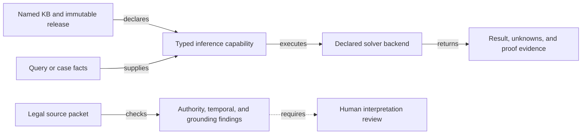
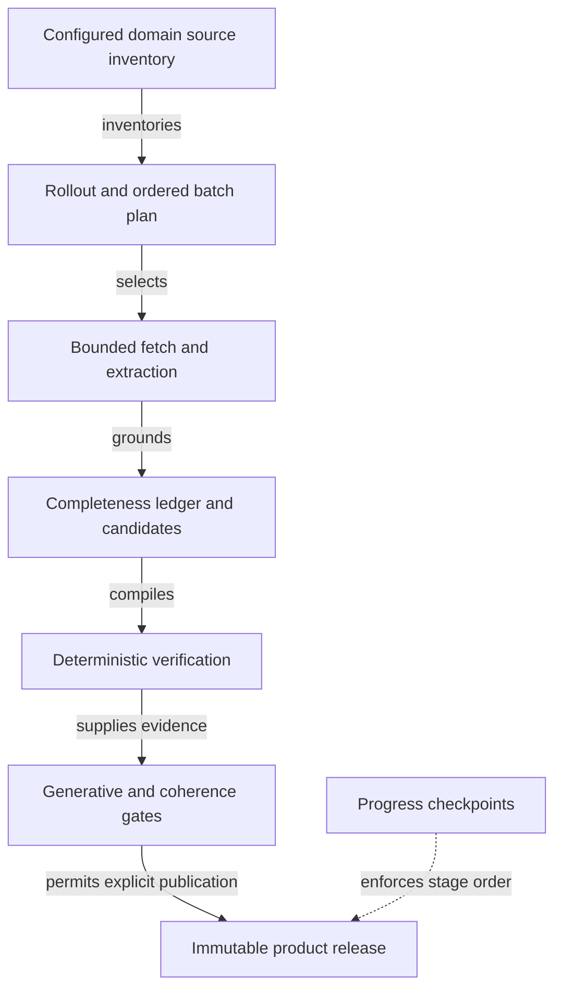
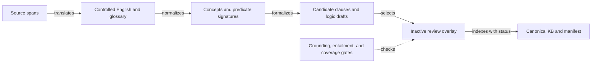
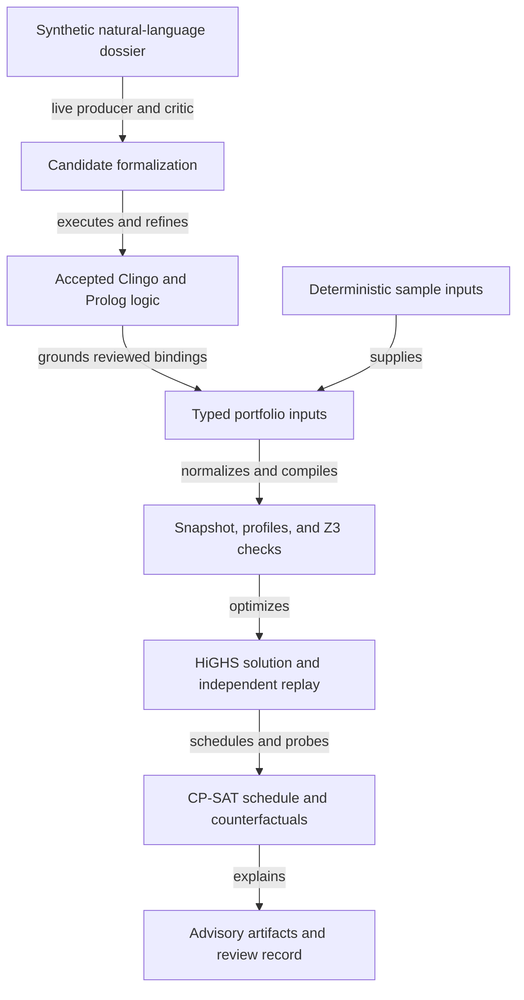
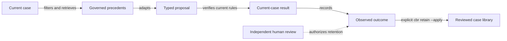
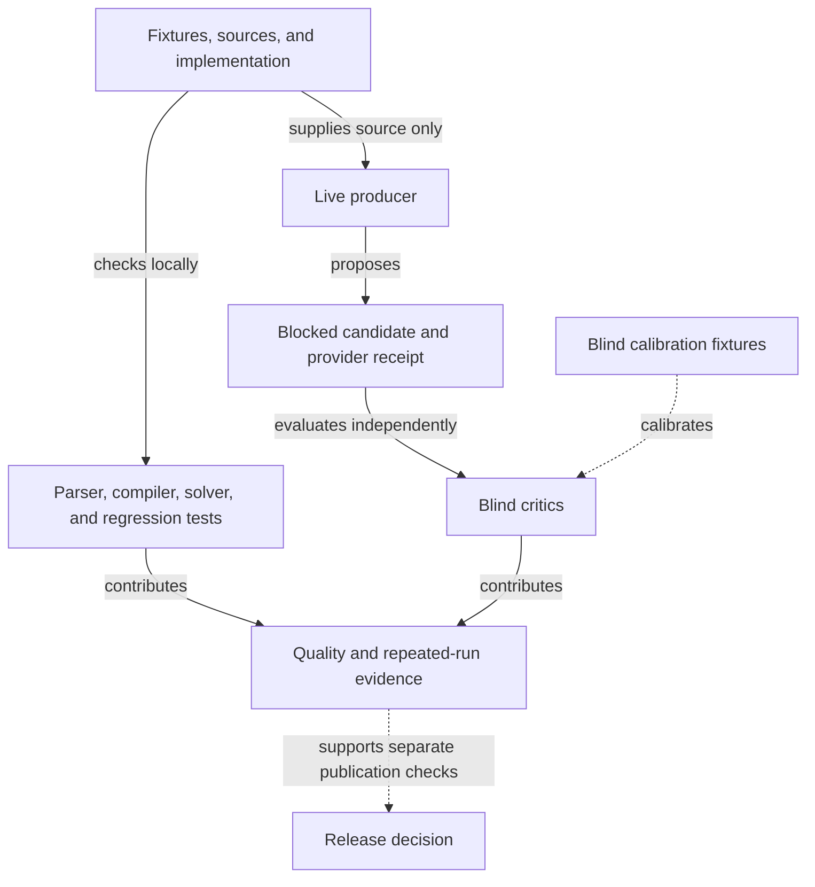

<!--
SPDX-FileCopyrightText: Copyright © 2026 Idiap Research Institute <contact@idiap.ch>
SPDX-FileContributor: André Freitas <andre.freitas@idiap.ch>
SPDX-License-Identifier: LicenseRef-Idiap-Research-Education
-->

# RULER detailed project guide

This guide preserves the detailed capabilities, examples, workflow descriptions,
integration instructions, and repository notes formerly on the root README.
Start with the [project README](../../README.md) for the concise introduction
and the [documentation index](../README.md) for the common reading structure.

RULER turns rigorous natural-language sources into formal knowledge bases, checked
decisions, and traceable explanations. It combines generative interpretation where
language is genuinely ambiguous with deterministic validation and solver-backed
reasoning at the decision boundary.

The result is not just an answer. A RULER run preserves the source evidence, accepted
facts and rules, assumptions, solver result, counterfactuals, and an explanation whose
claims can be traced back to those artifacts.

RULER runs on macOS, Linux, and Windows and has one canonical command surface. The same
workflows are available directly, from Codex, Claude Code, OpenCode, or through a
standalone Model Context Protocol (MCP) server.

## What RULER does

RULER supports four connected forms of reasoning:

- **Formal knowledge bases:** ingest and version source-grounded facts and rules; query
  them through declared ASP, Prolog, RDF, or optimization capabilities.
- **Controlled autoformalization:** propose formal statements from natural language,
  check their provenance and semantics, execute them in real logic backends, and refine
  defects before acceptance.
- **Deterministic decisions:** solve logical, numeric, scheduling, and portfolio models
  with Clingo, SWI-Prolog, Z3, HiGHS, SciPy, Pyomo, and OR-Tools as appropriate.
- **Grounded explanation:** communicate the recommendation, decisive trade-offs,
  sensitivity cases, and limitations without giving generated prose decision authority.

Case-based reasoning complements those capabilities. It retrieves analogous governed
cases and explains their similarities, but verifies the current case against the current
rules rather than copying a historical outcome.

```text
source evidence
      |
      v
semantic basis -> candidate facts and rules -> deterministic acceptance gates
                                                   |
                                                   v
                                      accepted formal knowledge base
                                                   |
                                                   v
                                logic / optimization / scheduling solvers
                                                   |
                                                   v
                              proof, counterfactuals, and grounded report
```

The central trust boundary is simple: generative components may interpret, draft, and
explain; accepted rules, validators, and solvers establish the computed result. RULER
reports unknown or unsupported conclusions explicitly instead of treating missing
evidence as false.

## Get started

To use the RULER skills as a **Codex or Claude Code plugin**, follow the
[plugin installation and packaging guide](plugins.md).

Requirements are Python 3.12 or newer, Git, and
[`uv`](https://docs.astral.sh/uv/). The lockfile manages the Python libraries and solver
bindings. Install SWI-Prolog separately only for workflows whose acceptance contract
requires an independent Prolog load and query check.

```bash
git clone <repository-url>
cd ruler
uv sync --extra dev
uv run ruler validate deps
uv run ruler --help
```

For the full test and validation gate, install SWI-Prolog (`brew install swi-prolog`
on macOS or `sudo apt-get install swi-prolog-nox` on Ubuntu), then prepare the browser
and generated report prerequisites:

```bash
uv run playwright install chromium
uv run ruler prepare checks
uv run ruler validate all
```

`prepare checks` uses recorded local evidence and runs no source downloads or live
generative calls. It generates reports before validation; validators themselves do
not repair missing inputs. On Linux, use `playwright install --with-deps chromium`
to install browser system dependencies too. Windows setup is covered in the
[cross-platform guide](cross_platform.md).

Run a first release-pinned formal evaluation:

```bash
uv run ruler evaluate regulatory-proof --case satisfied_boundary
uv run ruler evaluate regulatory-proof --case open_world_unknown
```

Run the end-to-end machine-portfolio demonstrator:

```bash
uv run ruler workflow resource-portfolio-demonstrator --kb-profile expanded
```

It builds a self-contained **Cost Optimization for Machine Portfolio** report. The
annual example connects a multi-project operating schedule to a machine acquisition
decision, shows the accepted autoformalized facts and rules, reconstructs the cost
objective, and reports every executed proof and sensitivity configuration.

When the desired workflow is not yet clear, start from natural-language intent:

```bash
uv run ruler route guide "compare alternatives and explain the decisive trade-offs"
```

This entry point is deterministic and offline-safe by default. Add `--allow-network`
only after configuring a real provider to obtain schema-constrained semantic guidance.
The guide can select only registered workflows and never executes its suggestions;
commands and skill metadata are reloaded from the trusted catalogue.

Before handing off a change, run the complete offline gate:

```bash
uv run ruler validate all
```

Live source acquisition and budgeted generative evaluations remain separate, explicit
operations, so the offline gate is reproducible and does not incur API use.

## Workflow catalogue

The tables below cover all **57 registered workflows**, grouped by purpose. Each row
reads **input → operation → output**. Run a workflow or its follow-up validator with:

```bash
uv run ruler workflow WORKFLOW [OPTIONS]
uv run ruler validate CHECK
uv run ruler workflow WORKFLOW --help
```

Uppercase words are placeholders. A check cell containing several names means run each
check separately; **built in** means the command itself performs the stated checks.
Solid diagram arrows show artifact handoffs; dotted arrows show validation or review.
The diagrams connect separately invokable commands, while each row describes one call.
**Live** identifies external source acquisition or model calls.

The executable sources are the [workflow registry](../../.ruler/workflows.yaml),
[CLI](../../ruler/cli.py), [hook definitions](../../.ruler/hooks.yaml), and
[skill bindings](../../skills/SKILL_HOOKS.yaml). Inspect their combined catalogue with
`uv run ruler workflow execution-catalogue`. Generated reports usually live under
`build/ruler/`; source and formalization workflows also write to `data/` and `kb/`.
Some `--output-dir` options create report copies while retaining those canonical writes.

- [Knowledge bases and formal evaluation](#knowledge-bases-and-formal-evaluation)
- [Source acquisition and product onboarding](#source-acquisition-and-product-onboarding)
- [Translation and formalization](#translation-and-formalization)
- [Resource portfolios](#resource-portfolios)
- [Case-based reasoning](#case-based-reasoning)
- [Assurance, logs, and workflow inspection](#assurance-logs-and-workflow-inspection)
- [Deterministic and generative testing](#deterministic-and-generative-testing)

### Knowledge bases and formal evaluation

These entry points use the `kb`, `evaluate`, and `legal` command families alongside the
registered workflows. They expose a KB's declared capabilities and preserve the release
and evidence behind each inference.



Sources: [KB inference](../../ruler/kb/workspace_inference.py),
[evaluation pipeline](../../ruler/evaluation/pipeline.py), and
[legal assurance](../../ruler/domains/legal/assurance.py).

| Command | Schematic |
|---|---|
| `uv run ruler kb list` / `kb show KB_ID` / `kb search TEXT --kb KB_ID` | Catalogue + manifests → list, inspect, or search → KB metadata and evidence locations. |
| `uv run ruler kb capabilities KB_ID` / `kb infer KB_ID --help` | KB manifest → discover typed query contracts → supported inference options. |
| `uv run ruler evaluate regulatory-proof --case open_world_unknown` | Pinned rules + case facts → applicability and consequence evaluation → explicit outcomes, unknowns, and trace. |
| `uv run ruler legal validate-packet kb/corpora/legal-sr101-art36/candidate/art36_packet.yaml` | Source-bound candidate packet → authority, temporal, and evidence checks → assurance findings and review requirements. |
| `uv run ruler serve kb-workspace` | Managed KBs and CBR libraries → authenticated local API → browser search, inference, and case exploration. |

Run `uv run ruler corpora validate` and `uv run ruler validate kb-workspace` to check the
corpus and workspace contracts. Legal solver evidence remains subject to the packet's
interpretation and human-review boundaries.

### Source acquisition and product onboarding

Prepare bounded batches, preserve source identities, and advance each batch through
explicit evidence gates before publication.



Sources: [onboarding](../../ruler/ingestion/progressive_onboarding.py),
[batch pipeline](../../ruler/ingestion/batch_pipeline.py).

| Workflow | Input → operation → output | Check |
|---|---|---|
| `progressive-product-onboarding` | Rollout inventory → prepare ordered, bounded batches → `plan.yaml`, progress ledger, pipeline catalogue, and templates. | `progressive-onboarding`, `batch-pipeline` |
| `product-batch-pipeline --batch-id BATCH --stage STAGE` | Batch catalogue + current evidence → execute one legal stage → status, stage artifacts, or gated release; generative verification makes **live** calls. | `batch-pipeline` |
| `onboarding-checkpoint --batch-id BATCH --stage STAGE --note NOTE` | Current ledger + evidence IDs → verify the requested transition → append one progress event. | `progressive-onboarding` |
| `verify-kb-consistency` | Canonical KB + onboarding state → read-only contract, semantics, Prolog-comment, reasoning, and statistics checks → gate results. | Built in |
| `kb-statistics` | Formal KB + releases + candidates + source manifests → descriptive counts → `build/ruler/kb_statistics/`. | `kb-statistics` |

The default plan has no batches. Configure domain sources before onboarding.
For a configured batch, inspect it with
`uv run ruler workflow product-batch-pipeline --batch-id BATCH --stage status`.
The [onboarding runbook](../operations/progressive_product_onboarding_runbook.md)
defines each stage's inputs, revision paths, and publication prerequisites.

### Translation and formalization

Keep source spans, controlled language, vocabulary, draft logic, and review status
connected. A candidate or review overlay retains its status when indexed in the KB.



Sources: [translation control](../../ruler/kb/translation_control.py),
[KB assembly](../../ruler/kb/formalized_kb.py).

| Workflow | Input → operation → output | Check |
|---|---|---|
| `translation-control` | Source units + terminology → build bilingual translations and align them to predicates → translation units, glossary, predicate map, and alignment report. | `translation-control`, `vocabulary-predicates` |
| `formalization-wave` | Wave manifests + reviewed overlays + skill evidence → calculate coverage and run grounding/entailment/governance checks → coverage inventory and unresolved blockers. | Built in: `formalization-wave`, `formalization-coverage`, `formalization-completion`, `formalization-governance` |
| `formalized-kb` | Canonical corpus manifests → validate artifact identities and hashes → `kb/manifest.yaml`. | `formalized-kb` |

These commands build and check the repository's controlled artifacts. The live
generative producer/critic loop is exposed by the portfolio demonstrator and the
[generative test workflows](#deterministic-and-generative-testing). Coverage reports
preserve unresolved work instead of treating artifact generation as completion.

### Resource portfolios

Choose resources and schedules from typed operational evidence, then independently
verify feasibility, costs, and the explanation. The natural-language demonstrator
adds accepted formal logic and reviewed source-to-solver bindings to that chain.



Sources: [portfolio workflow](../../ruler/applications/resource_portfolio/workflow.py),
[grounded demonstrator](../../ruler/applications/resource_portfolio/demonstrator.py), and
[formalization refinement](../../ruler/applications/resource_portfolio/demonstrator_formalization.py).

| Workflow | Input → operation → output | Check |
|---|---|---|
| `resource-portfolio-plan` | Packaged construction-fleet evidence and test inputs → normalize, compile, optimize, verify, schedule, and stress-test → `build/ruler/resource_portfolio/workflow_run.yaml` plus evidence and advisory reports. | `resource-portfolio`, `deterministic-skills` |
| `resource-portfolio-demonstrator` | Compact or expanded synthetic dossier → **live** Codex formalization/refinement, executable logic, reviewed bindings, and portfolio solving → accepted-rule views, proof receipts, explanations, and `build/ruler/resource_portfolio_demonstrator/index.html`. | `resource-portfolio`, `deterministic-skills` |

Use `--kb-profile expanded` for the larger demonstrator. Its accepted logic requires
Clingo and SWI-Prolog execution; the optimization uses HiGHS and the schedule uses
OR-Tools CP-SAT. `--reuse-formalization` loads an authenticated receipt matching the
requested profile; it is a reuse option for formalization, not a general offline mode.
Both workflows preserve an advisory human-review boundary.

### Case-based reasoning

Retrieve analogous cases, expose both similarities and excluded contrasts, propose an
adaptation, and verify the current facts against current rules.



Sources: [CBR workflow](../../ruler/cbr/workflow.py),
[case operations](../../ruler/interfaces/cbr_cases.py),
[benchmark](../../ruler/interfaces/cbr_benchmark.py), and
[demonstrators](../../ruler/interfaces/cbr_demonstrators.py).

| Workflow | Input → operation → output | Check |
|---|---|---|
| `cbr-case` | Governed demonstration cases and rules → validate retrieval, adaptation, and verification contracts → validation status. | Built in: `cbr` |
| `cbr-case-library-curation` | Declared case libraries → load and validate typed catalogues → read-only curation status; retention is a separate command. | `cbr` |
| `cbr-benchmark` | Five demonstration domains + expected outcomes → repeated retrieval, contrast, adaptation, and verification checks → JSON/Markdown metrics under `build/ruler/cbr/benchmark/`. | `cbr` |
| `cbr-demonstrators` | Governed demonstration cases → run retrieval and contrast it with five reviewed CBR journeys → interactive demonstrations and portfolio under `build/ruler/cbr_demonstrators/`. | `cbr` |

For individual operations, use `uv run ruler cbr retrieve spending`,
`uv run ruler cbr adapt spending spend-precedent-microscope-009`, and
`uv run ruler cbr verify spending`. Reviewed outcome retention uses
`uv run ruler cbr retain OUTCOME.json --apply`. Benchmark metrics describe deterministic
fixture behavior; precedent retrieval does not grant approval for the current case.

### Assurance, logs, and workflow inspection

Expose the evidence behind a result and the contracts behind each execution surface.
Skill capability profiles and actual invocation events remain separately inspectable.

Sources: [skill logs](../../ruler/interfaces/skill_reasoning_logs.py),
[execution registry](../../ruler/runtime/workflow_registry.py), and
[workflow graph model](../../ruler/interfaces/workflow_graphs.py).

| Workflow | Input → operation → output | Check |
|---|---|---|
| `skill-reasoning-logs` | Canonical skills + bindings + recorded invocations → write one profile per skill and preserve actual events → profile files, event stream, and manifest. | `skill-reasoning-logs` |
| `inference-dashboard` | Corpus manifests and evidence → inspect indexed logical artifacts → `build/ruler/inference_dashboard/index.html`. | `inference-dashboard` |
| `kb-visualizer` | KB manifest + released onboarding packages → catalogue logical artifacts and evidence → `build/ruler/kb_visualizer/index.html`. | `kb-visualizer` |
| `execution-catalogue` | Live CLI + registry + hooks + skills + client wrappers → validate and join execution metadata → `build/ruler/workflow_execution_catalogue.yaml` and `.md`. | `workflow-registry` |
| `workflow-router` | Intent routes + known workflows and skills → build the routing catalogue → inspectable routing artifacts under `build/ruler/workflow_router/`. | `workflow-router` |
| `workflow-graphs` | Workflow definitions + ordered steps + skills and hooks → construct graph/layout data → JSON and interactive HTML under `build/ruler/workflow_graphs/`. | `workflow-graphs` |

Use `uv run ruler route guide "describe the desired outcome"` to select a registered
route from intent. The guide returns suggested commands; execution remains a separate
step. Reasoning logs contain observable facts, decisions, and artifact references.

### Deterministic and generative testing

Use local checks for source integrity and executable semantics, then invoke live
profiles when fresh producer or critic evidence is needed. The test workflows collect
evidence; product release publication has its own workflow and prerequisites.



Sources: [CLI test runners](../../ruler/cli.py),
[live test cases](../../tests/generative/test_autoformalization_live.py),
[profile contracts](../../ruler/testing/autoformalization_profiles.py),
[quality evaluator](../../ruler/runtime/generative_quality.py), and
[judge calibration](../../ruler/runtime/generative_calibration.py).

| Workflow | Input → operation → output | Check |
|---|---|---|
| `test-deterministic` | Repository code and tests → run `pytest -q`, `ruff check .`, and `git diff --check` → deterministic gate status. | Built in |
| `test-generative-local` | Autoformalization fixtures and recorded evidence → network-free source, replay, parser, compiler, solver, and mutation checks → local profile status. | Built in |
| `test-generative-smoke` | Two source styles → **live** Codex candidate generation and receipt/schema assertions → smoke status; projections remain blocked. | Built in |
| `test-generative-pr` | Three catalogue cases → one **live** producer run per case → advisory candidate receipts under `build/ruler/generative/pr/`. | Built in |
| `test-generative-integration` | Local profile + all five catalogue cases → **live** producer and one independent critic per case → integration receipts. | Built in |
| `test-generative-release` | Local profile + five cases → three fresh **live** repetitions, with two critics per case → per-case release-profile receipts. | Built in |
| `test-generative-drift` | Local profile + five cases → two fresh **live** repetitions, with two critics per case → per-case drift-profile receipts. | Built in |
| `generative-kb-quality --profile PROFILE` | Bounded case catalogue + artifact evidence + rubric → **live** judge evaluation and, for blocking profiles, consensus checks → findings and consensus bundles under `build/ruler/generative_quality/`. | `generative-kb-quality`; blocking consensus is checked within the command |
| `calibrate-generative-judge --model MODEL --codex-version VERSION --judge-config CONFIG` | Blind calibration fixtures or prior results → **live** execution or deterministic threshold recalculation → observations and model/config-bound certification. | Built in; unsuccessful calibration fails |

For `generative-kb-quality`, `--profile pr --dry-run` inspects a bounded request without
calling the model; `--case-id` narrows the selected profile. Calibration requires exactly
one of `--execute` or `--results RESULTS.yaml`. Live autoformalization profiles use fresh
Codex calls, preserve producer/critic identity, and leave candidate activation blocked.

## Run from an agent or MCP client

All integrations route to the same CLI, typed contracts, solvers, and validation gates;
none maintains a separate implementation.

| Environment | Project integration | Check |
|---|---|---|
| Codex | Repository instructions and canonical skills | `uv run ruler validate codex` |
| Claude Code | Project memory and slash-invoked skill wrappers | `uv run ruler validate claude-code` |
| OpenCode | Project instructions, skills, and commands | `uv run ruler validate opencode` |
| Any MCP client | Bounded stdio server built with FastMCP | `uv run ruler validate mcp-server` |

For Codex, open the repository and ask it to use a skill from the canonical catalogue or
run a named RULER workflow. Claude Code and OpenCode expose project-local wrappers over
that same catalogue; their bridge validators reject commands that drift from the CLI.

To run RULER as a standalone MCP server:

```bash
export RULER_DATABASE_URL='postgresql+pg8000://ruler@localhost/ruler'
uv run ruler database upgrade
uv run ruler database import-workspace --source .
uv run ruler validate api-config
uv run ruler validate mcp-server
uv run ruler config generative
uv run ruler serve mcp
```

Configure an MCP client to launch `uv run ruler-mcp` with the repository as its working
directory. The server exposes bounded workflow routing, validation, KB inference, and
read-only case operations—not arbitrary shell or filesystem access. Artifact-writing
workflows require an explicit write flag.

All MCP persistent data lives in PostgreSQL, with Alembic migrations. Import initializes
a new database workspace once; subsequent MCP calls use database state and disposable
temporary execution files. Set `RULER_MCP_WORKSPACE` to select a workspace other than
`default`. See the [MCP guide](mcp_server.md) for setup and storage details.

RULER works offline with its deterministic local provider. To enable a supported remote
generative provider, select it with `RULER_GENAI_PROVIDER`, set the referenced credential
environment variable, choose a model with `RULER_GENAI_MODEL`, and explicitly set
`RULER_GENAI_ALLOW_NETWORK=true`. Configuration inspection is redacted and never prints
the credential. The [MCP guide](mcp_server.md) contains a complete client
configuration and safety contract.

## Cross-platform operation

Use the same commands in PowerShell, Windows Terminal, or a POSIX shell:

```bash
uv sync --extra dev
uv run ruler validate cross-platform
uv run ruler validate all
```

Required workflows use Python and argument-list subprocess execution rather than shell-
specific utilities. Git hooks are optional for use and can be installed portably with
`uv run python scripts/install_hooks.py`. See the
[cross-platform guide](cross_platform.md) for the portability contract.

## Dependencies and licenses

Runtime, solver, document-processing, service, and development dependencies are declared
in `pyproject.toml` and resolved reproducibly by `uv.lock`. `uv sync --extra dev` installs
the tested environment and `uv run ruler validate deps` checks required imports and
backend availability.

RULER is licensed for non-commercial research and educational use only; see [LICENSE](../../LICENSE). Dependency license names, upstream project links, and the
method used to produce the inventory are collected in
[Dependency licenses](../governance/LICENSES.md). Those packages remain governed by
their respective licenses.

The [Idiap software disclosure guide](../development/software-disclosure.md) documents
`main` as the source-only branch and `development` as the complete development
checkout, including evidence and SD/agent support. These inputs are ignored on
`main` and can be restored locally. CI obtains evidence from a pinned development
revision and runs project checks independently of SD tooling. No disclosure archive
is retained. See the guide for setup and the limits of the branch separation.

## Documentation

- [Getting started](../getting-started.md)
- [Documentation index](../README.md)
- [System architecture](../architecture/system_architecture.md)
- [Trust and assurance model](../concepts/trust-and-assurance.md)
- [Knowledge-base workspace](kb_workspace.md)
- [Case-based reasoning](cbr_demonstrators.md)
- [MCP server](mcp_server.md)
- [Portable deployment](deployment.md) — Host-neutral containers and PostgreSQL.
- [Claude Code](claude_code.md)
- [OpenCode](opencode.md)
- [CLI reference](../reference/cli.md)
- [HTTP API reference](../reference/http-api.md)
- [Contributing](../development/contributing.md)

Generated reports and dashboards are reproducible outputs. Change the typed source,
formalization, registry, or workflow and regenerate them rather than editing a result by
hand.
