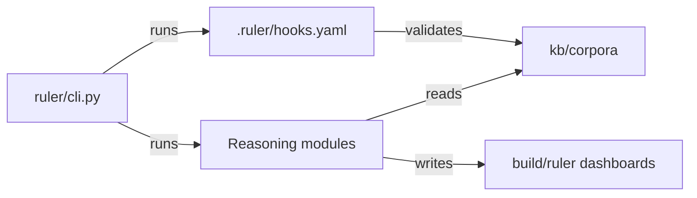
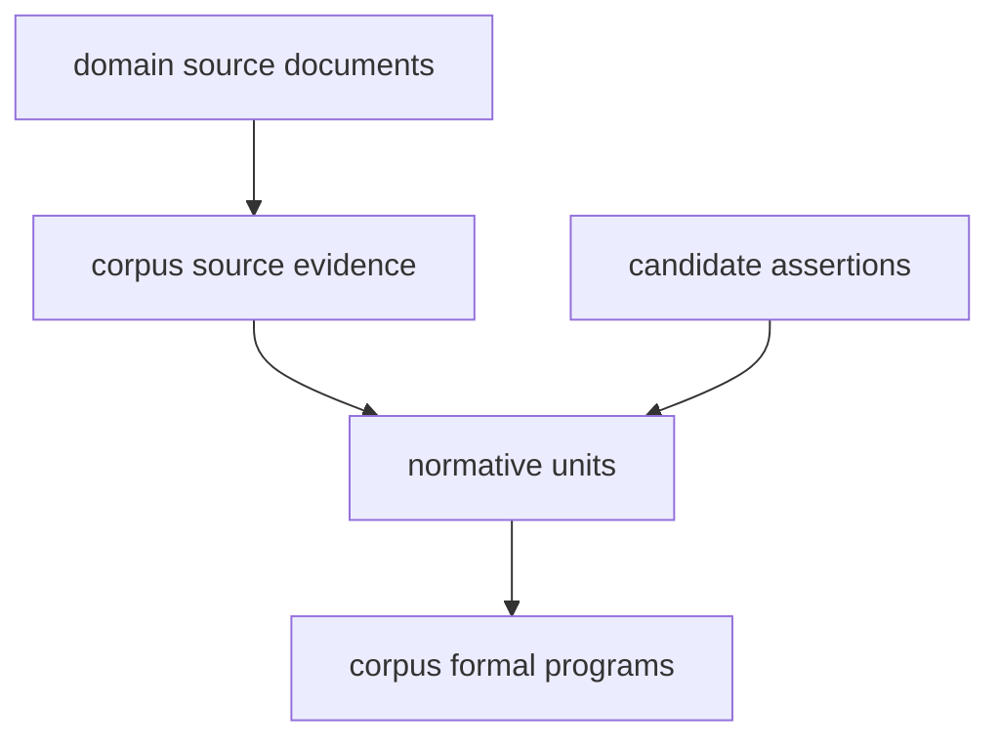

# Project Component Diagrammer

Use this skill when the user wants diagrams or visual architecture explanations for
RULER components, workflows, KBs, skills, hooks, interfaces, or runtime integrations.

## Procedure

1. Choose the diagram view before drawing:
   - system context
   - container/component view
   - data flow
   - control and validation flow
   - KB organization
   - runtime integration
2. Read source files that define the relationships being drawn.
3. Prefer Mermaid for text-first docs and JSON-backed generated views for dynamic dashboards.
4. Label edges by relationship type: reads, writes, validates, generates, mirrors, routes, or gates.
5. Make real/synthetic and promoted/candidate boundaries visible.
6. Include a short legend and the source files used to derive the diagram.

## Diagram Patterns

### Component View

### KB View

## Outputs

- Mermaid blocks in Markdown docs.
- Diagram source files under `docs/communication/` when the diagram is durable.
- Generated HTML or JSON only when a workflow or dashboard needs interactivity.

## Gates

- Every diagram should name the source files used to derive it.
- Do not show candidate-only artifacts as active reasoner truth.
- Do not omit validation hooks when showing a promotion or formalization flow.
- Keep diagrams readable at one screen width; split dense diagrams into multiple views.
