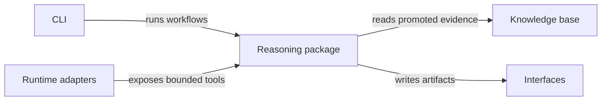
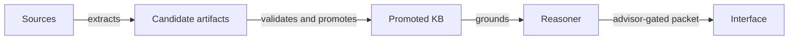

# Architecture Diagram Builder

Use this skill when creating or refreshing RULER system, component, data-flow, or
control-flow diagrams.

## Procedure

1. Choose one diagram intent before drawing:
   - system context
   - component/package view
   - source-to-KB data flow
   - reasoning control flow
   - runtime integration view
2. Read the files that define the relationships being drawn.
3. Prefer Mermaid in Markdown for durable docs.
4. Label edges with verbs such as reads, writes, validates, routes, generates,
   promotes, blocks, exposes, or renders.
5. Show boundaries explicitly:
   - raw source corpus
   - extracted/candidate artifacts
   - promoted KB artifacts
   - reasoning engine
   - human-facing interfaces
   - runtime adapters
6. Include a short source note naming the files used to derive the diagram.

## Mermaid Patterns

### Component View

### Control Boundary View

## Gates

- Keep each diagram readable at one screen width.
- Split dense diagrams into multiple focused views.
- Do not imply candidate artifacts bypass promotion gates.
- Do not hide validation or human-review controls.
